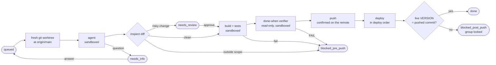

<p align="center">
  
</p>

<h1 align="center">Agentry</h1>

<p align="center">
  <strong>An AI software-delivery queue with guardrails.</strong><br>
  Describe a change. Agentry has an AI agent build it in a sandbox, puts it through tests and an independent
  review, then pushes and deploys it, and confirms that production is running the new commit.
</p>

<p align="center">
  <a href="LICENSE"></a>
  
  
  
  
</p>

---

Coding agents can write code. Letting one ship that code is harder: something has to check that it changed only
what it was asked to, that it didn't weaken the tests, and that it never got near your credentials. And when
a deploy fails halfway, something has to know which machine runs which commit.

**Agentry is that missing layer.** Each change request goes through a fixed pipeline. Every step that runs
agent-written code is sandboxed, every gate fails closed, and every failure stops in a named state with a clear
next action. Nothing reaches production on a guess.

```
 "Show similar words under each answer"          ─►  queued
   done when: the API returns up to 5 similar    ─►  agent (sandboxed) ─► inspect ─► build ─► test
   words and the web page lists them             ─►  done-when verifier ─► push ─► deploy
                                                 ─►  api runs 3f9c2e1 ✓   web runs 3f9c2e1 ✓   done
```

## Contents

- [Highlights](#highlights)
- [How a request flows](#how-a-request-flows)
- [Multi-project and multi-repository delivery](#multi-project-and-multi-repository-delivery)
- [Queue, leases and deploy-group locks](#queue-leases-and-deploy-group-locks)
- [Automated deployment](#automated-deployment)
- [Security model](#security-model)
- [Fail-safe controls](#fail-safe-controls)
- [The web UI](#the-web-ui)
- [Image attachments](#image-attachments)
- [Getting started](#getting-started)
- [Recipes](#recipes)
- [CLI reference](#cli-reference)
- [Configuration](#configuration)
- [Backups and retention](#backups-and-retention)
- [Architecture](#architecture)
- [Quality](#quality)
- [Platform support and roadmap](#platform-support-and-roadmap)
- [License](#license)

## Highlights

| | |
|---|---|
| **Request to production** | One request goes from plain-language intent to a deployed, verified commit with no hand-offs. |
| **Sandboxed agent** | The agent, the build, the tests and the verifier run under a macOS `sandbox-exec` allowlist, or on Windows as a separate low-privilege user inside a job object. They cannot read your home folder, keychain, SSH agent or your own checkout. |
| **Scope enforcement** | Each project owns a folder. If a change touches a file outside the selected projects, the request stops before push, and no approval can override that. |
| **Anti-gaming gates** | Changes to build files and gate paths, deleted tests, newly skipped tests and lower test counts all wait for human review. |
| **Independent verifier** | A second, read-only model call checks the diff against your *done-when* line, and is told to be strict. Passing tests alone don't count as proof. |
| **Verified deploys** | After each deploy, Agentry reads every target's live `VERSION` and compares it with the pushed commit. A mismatch is a failure. |
| **Multi-project requests** | One request can span several projects in one repository: one change, one commit, deploys in a set order. |
| **Multi-repository queue** | Register any number of projects across any number of repositories. They all share one prioritized queue. |
| **Deploy-group locks** | Projects that deploy to the same target never deploy at the same time. After a failed deploy, the group stays locked until a person resolves it. |
| **Crash-safe runner** | A lease, fenced writes and startup recovery mean a killed runner never double-deploys, never loses track of a push and never leaves processes behind. |
| **Phone-friendly web UI** | Sign in with a passkey (Face ID / Touch ID), queue requests, attach screenshots, answer the agent's questions, approve, retry and re-deploy from anywhere. |
| **Human in the loop where it matters** | The agent can ask a question instead of guessing. You review only the changes that carry risk. |
| **Audit trail and backups** | Every state change is logged with who made it. Nightly backups cover the database, every in-flight branch and all attachments. |

## How a request flows



1. **Pick.** The runner takes the highest-priority, oldest queued request whose projects are enabled and whose
   deploy groups are all free.
2. **Drift guard.** Before it touches a deploying group, Agentry reads every target's live version. A target that
   runs a commit missing from `origin`, or one with uncommitted changes, blocks its group. Agentry never builds on
   top of a production state it can't explain.
3. **Worktree.** The run gets a new git worktree on branch `agentry/<request>-<attempt>`, starting at the remote
   head. Agentry never checks out, resets or commits to your own checkout.
4. **Agent.** Claude Code makes the change inside the sandbox. Its prompt includes the request, the done-when
   line, your earlier answers, any attached images, and the `CLAUDE.md` / `AGENTS.md` of each selected project.
   If the request is ambiguous, or the change needs code outside its scope, the agent replies `NEEDS_INFO`
   and changes nothing.
5. **Candidate commit and inspection.** Everything the agent changed is committed as a candidate, and the diff
   goes through the [inspection gates](#fail-safe-controls).
6. **Build and test.** Both run in the sandbox. Agentry reads test results from a TRX file and compares the
   counts with the project's last passing run.
7. **Done-when check.** If the request names a test (`done_when_test`), every test that matches the name must
   pass. If it has a done-when line, the verifier must return `PASS` and cite evidence.
8. **Push.** The commit message carries an `Agentry-Request: #<id>` trailer. If `origin` has moved, Agentry
   rebases and **runs every gate again** before pushing. The remote, not the exit code, decides whether the push
   landed.
9. **Deploy and confirm.** Each project's deploy runs from a clean worktree at exactly the pushed commit. Agentry
   then checks each target's live version.

The request ends as `done` with reason `deployed`, or `built` for projects that have no deploy step, such as an
iOS app you upload to TestFlight yourself.

### Request states and your actions

| State | Meaning | Actions |
|---|---|---|
| `queued` / `running` | Waiting for the runner, or in progress. | Cancel (queued) |
| `needs_info` | The agent asked a question. | **Answer** (with optional images), Cancel |
| `needs_review` | A gate flagged a risky change: build file, deleted or skipped test, gate path. | **Approve** (resumes at build), Reject |
| `blocked_pre_push` | Stopped before anything left the machine: build, tests, verifier, scope or a rebase conflict. | **Retry**, **Retry with edits**, Cancel |
| `blocked_post_push` | The commit is on `origin` but the deploy failed or couldn't be confirmed. Its deploy groups are locked. | **Re-run deploy**, Mark resolved |
| `done` | Deployed and confirmed, or built. | **Reopen** with what's wrong (adds a linked request and counts a *false-done*) |
| `done_manual` / `canceled` | Resolved by hand, or dropped. | — |

Every stop removes the worktree and **keeps the branch**, so you can always inspect what the agent did.

## Multi-project and multi-repository delivery

### Many repositories, one queue

A **project** is one folder of one repository: its `scope_path`, plus a [recipe](#recipes) that says how to
build, test and deploy it. You can register as many projects as you like, from as many repositories as you
like, and they all share one prioritized queue. A backend, a web front end and an iOS app can live in one
monorepo or in three separate repos, and Agentry serves them the same way.

### One request, several projects

Real changes often cross project lines: a new API field and the page that shows it, or a server endpoint and
the app that calls it. Pick several projects for one request in the web UI's multi-select, or pass a
comma-separated list on the command line:

```sh
agentry add api,web "Show similar words" --done-when "GET /words/{id} returns up to 5 similar words and the word page lists them"
```

For a multi-project request, Agentry:

- **Combines the scopes.** The agent may change files under any selected project's folder, and only there.
- **Runs each distinct command once.** If two projects share a build, test or deploy command, it runs a single
  time. Test counts are still recorded per project, so each project keeps its own baseline.
- **Deploys in order.** Projects deploy lowest `deploy_order` first, so the server ships before the client that
  depends on it.
- **Handles partial failure exactly.** When one deploy fails, only that project's group and the groups not yet
  reached are locked. Projects that deployed earlier stay live. **Re-run deploy** skips every project whose
  targets already run the commit.
- **Names the missing project.** If the agent changes a file that belongs to a project you didn't select, the
  stop reason names that project (`web/Pages/Word.razor (web, not selected)`), so you know what to add on retry.

All projects in one request must share a repository and branch. That rule is what makes the change one atomic
commit.

### Scope is a hard boundary

A change outside every selected project's scope is a **hard stop**, not a review item, and approval can't push
it through. Without this rule, a change filed under the backend could edit the iOS app, pass review, and
"deploy" a backend that never changed while the iOS change went nowhere.

## Queue, leases and deploy-group locks

Agentry is built so that two processes can never act on the same request or the same production target.

### The runner lease

- **One executor at a time.** `agentry run` takes a database lease: a random token with a 60-second TTL, renewed
  every 15 seconds by a heartbeat. A second runner refuses to start while the lease is live and names the pid
  that holds it.
- **Fenced writes.** Every state change the runner makes runs in a transaction that first checks it still owns
  the lease. If another runner has taken over, for example after a long system sleep, the old one's writes are
  refused and it exits with code 3. A stale runner can never overwrite a newer runner's decisions.
- **Graceful stop.** `Ctrl-C` lets the current request finish. Pressing it again quits at once, and startup
  recovery cleans up on the next run.

### Deploy groups

Projects that deploy to the same place share a **deploy group**. For example, an API and a web app might be
published by one script to one server.

- The queue skips any request whose groups aren't all free, so **two deploys to one target never overlap**, even
  across different requests and projects.
- A failure after push (deploy failed, timed out, live version wrong, push outcome unknown) **locks the group**,
  with the reason and the commit that didn't deploy. Nothing else deploys there until a person acts: re-run the
  deploy, mark it resolved, or unblock it.
- A drift-guard stop locks only the drifted project's group and puts the request back in the queue. That
  attempt doesn't count against it.

### Remote busy check

A recipe can include a `remote_busy_cmd` that asks the target whether an earlier install is still running,
whether Agentry or a person started it. Exit `0` means busy, `1` means free, and anything else means *unknown*.
Busy and unknown both stop the deploy. Agentry never starts an install on top of another.

### Ordering

Requests run by priority (`--priority N`), then oldest first. A queued **Re-run deploy** always goes before new
work, because its group stays blocked until it's handled.

## Automated deployment

Deploys are fully automatic, and Agentry checks the result instead of assuming it.

- **Exact commit, clean tree.** Before each deploy, the worktree is cleaned of every untracked and ignored file,
  and Agentry checks that `HEAD` is exactly the pushed commit with no tracked changes. Nothing a sandboxed step
  left behind (a planted MSBuild `.targets` file, say) survives into an unsandboxed deploy.
- **Live-version confirmation.** Each recipe lists `targets`, each with a `live_version_cmd` that prints the
  target's `VERSION` line (`<short-sha>[+uncommitted] <date> <time>`). After the deploy, every target must report
  the pushed commit, resolved to a full, unambiguous SHA. A target that reports an older commit, or
  `+uncommitted`, fails the deploy.
- **Deploy order** across the projects of one request, as described above.
- **Never a rollback.** Re-run deploy only moves a target forward. It deploys when a target is behind, skips
  targets that already run the commit or a later one containing it, and refuses outright if deploying would
  roll a target back to an older commit.
- **Per-step timeouts.** A deploy that times out is reported as *remote state unknown* and the group is locked.
  Agentry won't treat an unconfirmed deploy as done.
- **Build-only projects.** Leave out `deploy_cmd` and a request ends as `built`, which suits App Store builds and
  other manual release steps.

## Security model

Agentry treats agent-written code as untrusted from the moment it's written until a person or a gate has
cleared it. Defenses are layered, so no single control is the only barrier.

### 1. The step sandbox

Every step that runs agent-written code (the agent, the build, the tests and the verifier) runs under a macOS
`sandbox-exec` profile ([`sandbox/run.sb`](sandbox/run.sb)) built as an allowlist:

| | Allowed | Denied |
|---|---|---|
| **Read** | The run's worktree, the run's temp dir, Agentry's package cache, the repo's git metadata (read-only), the `claude` binary, the API-key helper | Your home folder, `/tmp`, the per-user temp and cache area, **including your own checkout of the same repo** |
| **Write** | The worktree, the run's temp dir, the package cache | Everything else |
| **IPC** | What builds and TLS need | The data-protection keychain (`securityd`), and Unix sockets in `/tmp`, your home folder and the per-user area, which includes **the SSH agent** |

On top of that, each step gets a **scrubbed environment**. `HOME`, `TMPDIR` and `CLAUDE_CONFIG_DIR` all point
into the run's own temp dir, so nothing carries over between runs and nothing from your shell leaks in. The
`dotnet` toolchain is pinned to a single process, so sandboxed code can't reach your own unsandboxed MSBuild
nodes or compiler server.

A **sandbox canary** test suite runs the real profile against your real home folder. It checks that `~/.ssh`,
`~/.aws`, `~/.config`, `~/.docker`, `~/Library/Keychains` and your checkout are unreadable, that writes outside
the worktree fail, that the SSH agent and login keychain can't be reached, and that the environment is
scrubbed.

**On Windows** there is no `sandbox-exec`, so the boundary is a Windows user. Agentry runs as `AgentryRunner`, and
every sandboxed step runs as `AgentrySandbox`, a second standard user. For each run, the runner grants that user
write access to the worktree, the run's temp dir and the package cache only, and read access to the repo's git
metadata. Everything else is the Windows default for a user with no files of its own. Setup also denies it writing
the top-level folders of `C:\` that every user may otherwise change, and logging on to SQL Server. Each step
runs inside a job object with a memory cap (8 GB) and a CPU cap (50 %), so it can't starve the machine's other
services. `setup/windows-setup.ps1 -SelfTest` runs the Windows checks
([`test/windows.test.ts`](test/windows.test.ts)) as the runner account: the step runs as the sandbox user, can't
read the runner's secrets or `C:\Sites`, can't write the runner's home, and is stopped by the memory cap and
killed with its whole tree on a timeout.

### 2. A locked-down agent

- Claude Code runs headless with an explicit tool list (`Bash, Read, Edit, Write, Glob, Grep` for the agent;
  `Read, Grep` only for the verifier), `--strict-mcp-config`, and no session persistence.
- With an API key it runs `--bare`: no hooks, plugins, keychain or `CLAUDE.md` discovery. With a subscription
  token it runs `--safe-mode` and reads settings only from the run's empty config dir, **never from the
  worktree's agent-writable `.claude/` folder**.
- The prompt forbids commits, pushes, deploys and edits to build, CI or gate files. The gates enforce those
  rules anyway, so they don't depend on the prompt being followed.

### 3. Git hardening

- **Worktrees only.** Your own checkout is never modified.
- **Pinned worktrees.** A sandboxed step can write the whole worktree, including its `.git` pointer file. If
  unsandboxed git followed a rewritten pointer, it would run config of the agent's making (`core.fsmonitor`,
  filter drivers, `hooksPath`). So Agentry records each pointer when it creates the worktree, passes the real
  `--git-dir` and `--work-tree` on every git command, turns off fsmonitor and hooks, and **stops the run if the
  pointer changes** during any step.
- **Bounded git.** Every git process runs in its own process group with a timeout (network 120 s, `ls-remote`
  30 s) and with `GIT_TERMINAL_PROMPT=0`, so it can never hang waiting for credentials.

### 4. Review gates for anything that executes at build time

Deploys, and the few builds that can't run sandboxed, run with your privileges. So **any change to a file that
executes code at build time needs a person's approval**: `*.csproj`, `*.props`, `*.targets`,
`Directory.Build.*`, `NuGet.config`, `global.json`, `*.sh`, `*.ps1`, `Package.swift`, `.tools/`, and Xcode's
`*.pbxproj`, `*.xcscheme` and `*.xcconfig`. Matching is case-insensitive, because APFS and NTFS are, so
`directory.build.props` can't slip past.

### 5. Credentials

- Claude is authenticated with an **API-key helper** script or a **`claude setup-token` subscription token**,
  saved with mode `600` by `agentry token`. Neither touches the keychain.
- The tests, build and agent never see your git credentials, SSH keys or cloud credentials. Agentry pushes and
  deploys from outside the sandbox, after the gates.

### 6. The web UI

- **Passkeys only.** Sign-in uses WebAuthn with user verification required (Face ID, Touch ID or a device PIN).
  There are no passwords to phish or reuse.
- **Invite-only accounts.** `agentry user add` runs on the server host and prints a one-time registration link
  (single use, 30 minutes). `agentry user reset` revokes a user's passkeys and sessions in one step.
- **Only hashes at rest.** Session tokens, registration codes and login challenges are stored as SHA-256 hashes.
- **Brute-force throttle.** After 10 failed sign-ins in 15 minutes, a client address is blocked.
- **Browser hardening.** The server listens on `127.0.0.1` only. It has a Host allowlist against DNS rebinding,
  an Origin check on every POST, and cookies set `HttpOnly`, `SameSite=Strict` and `Secure` over HTTPS. Pages
  carry a strict Content-Security-Policy (scripts from self only, no framing, `form-action 'self'`), plus
  `X-Frame-Options: DENY` and `nosniff`.
- **Output escaping by default.** Every value on a page is HTML-escaped unless it's explicitly markup. Request
  text, logs and diffs, all written by people or agents, never become markup.
- **One code path for state.** The web UI and the CLI call the same state actions, so a state rule lives in one
  place, and each action records its actor (`user:<name>` or `cli`) in the audit log.

### Known limits

We'd rather you know where the boundaries are:

- The sandbox **leaves the network open**, because package restores and the agent itself need it. Harden
  services on the runner host that trust local connections.
- The API key or subscription token is **readable from inside the sandbox**, since the agent needs it. Use a
  dedicated, revocable key.
- Deploy commands, and builds marked `build_unsandboxed`, run with your privileges. That's why the review gates
  above exist.
- On Windows, the sandbox user **can read whatever Windows lets every user read**, and it can **list the names**
  (not read the contents) of the files in Agentry's own folder, because PowerShell needs to look its starting
  folder up in each parent. Firewall rules per user don't cover loopback, so it can reach local services too.

## Fail-safe controls

Every gate fails closed, and every failure is named.

### Inspection gates

| Flag | Trigger | Effect |
|---|---|---|
| `out_of_scope` | A changed file outside every selected project's `scope_path` | **Hard stop** (`blocked_pre_push`), no approval possible |
| `build_file` | A change to any build-time-executing file (see above) | `needs_review` |
| `gate_path` | A change matching the recipe's `gate_paths` (CI, schemas, the recipe itself, …) | `needs_review` |
| `test_deleted` | A test file deleted, or fewer tests than the last passing run | `needs_review` |
| `test_skipped` | An added line matching a skip pattern (`Skip =`, `XCTSkip`, `.disabled(`, …), or more skipped tests than the last passing run | `needs_review` |
| `test_added` | A new test file | Shown for information |

When you approve, the run resumes at **build** on the same branch. The agent doesn't run again, and the build,
tests and verifier still have to pass.

### Integrity checks

- **Tests must not edit tracked files.** If the test step leaves tracked changes, the run stops.
- **Strict verifier.** The verifier must end with `VERDICT: PASS|FAIL` and `EVIDENCE:` naming the files and lines
  that decide it. An unreadable reply counts as `FAIL`, never `PASS`. Diffs are capped at 150,000 characters,
  and the verifier can still read the full files.
- **Re-gate after a rebase.** If `origin` moved during the run, Agentry rebases and runs every gate again. A
  rebase conflict stops the run, and a push that's rejected twice stops it.
- **Push truth comes from the remote.** Agentry records `push_started` before pushing, then asks the remote with
  `ls-remote`, retrying after 2, 10 and 30 seconds. If the remote can't be reached, the request becomes
  `push_unknown` and its groups are locked. The runner keeps asking every minute and settles the request as
  soon as the remote answers.

### Process control

- **Process groups everywhere.** Every step and every git command runs in its own process group. On a timeout,
  the whole group gets `SIGTERM`, then `SIGKILL` after a grace period. Leftover processes from a step that
  exited normally are cleaned up the same way. On Windows, a small helper ([`tools/runas`](tools/runas)) puts
  each one in a job object instead, and killing the helper kills the whole tree.
- **Per-step timeouts**, with defaults and per-recipe overrides: agent 30 min, build 15, test 20, verify 5,
  deploy 30, version read 1.
- **Capped logs.** Step output stops being written at 50 MB, after a marker line, so a runaway step can't fill
  the disk.

### Infrastructure failures pause, they don't burn attempts

A usage limit, an auth failure, a network outage or a crashed agent counts as an **infrastructure error**. The
request goes back to the queue without counting the attempt, and **the runner pauses** with the reason. You
fix the cause and press **Resume**.

### Startup recovery

Every time a runner takes the lease, before it picks up any work, it:

1. Kills the recorded process group of every run it doesn't own, such as a push or deploy left by a crashed
   runner.
2. Deletes leftover worktrees and temp dirs, and prunes git's worktree list. This happens only after those
   processes are dead, so a killed deploy never loses its directory mid-run.
3. Asks the remote about every unresolved push.
4. Marks runs whose lease expired as interrupted, and lets **the remote decide** the request's state. If the
   commit (or one with its `Agentry-Request` trailer) is on `origin`, the request becomes `blocked_post_push`
   with its groups locked. If not, it becomes `blocked_pre_push`. If the remote can't be reached, it becomes
   `push_unknown` with its groups locked.

## The web UI

A fast, server-rendered UI that works on a phone. You can add it to the iOS home screen, and it follows the
system's light or dark mode.

**Home**

- **Status line:** runner online or offline, queue length, and the age of the last backup.
- **New request:** a multi-select project picker, title, details, a done-when line, an optional done-when test
  name, and up to five images.
- **Needs you:** every request waiting on a person, with the actions that fit its state. Also shown here: a
  paused runner (**Resume**), a blocked deploy group (**Unblock**), and a warning when the last backup is more
  than 48 hours old.
- **Queue:** what's running and what's next.
- **Recently finished:** the last ten requests, with **Reopen** on each done request.

**Run page**

- Request summary, attempt, branch, commit and push state.
- A **step table** with exit codes and timings, where each step's log is one click away.
- A **live log** that refreshes every 2 seconds while the step runs.
- **Flags** raised by the inspection gates.
- The **diff stat** and the full diff.
- The **recipe** the run used, read-only.

To reach it from outside the machine, put Agentry behind an HTTPS reverse proxy or a private network (such as
Tailscale Serve), and set `AGENTRY_PUBLIC_URL` to the address your browser sees. Passkeys require HTTPS
everywhere except `localhost`.

## Image attachments

A screenshot often explains a bug faster than a paragraph does.

- Attach up to **5 images per request**, each up to **10 MB**, when you **add** a request or **answer** the
  agent's question. On a phone, the picker offers the camera, the photo library and files.
- Agentry accepts **PNG, JPEG, GIF and WebP**, identified by their first bytes and never by file name or the
  browser's content type. HEIC photos get a clear message telling you to send a screenshot or a JPEG.
- Each run copies the images into its sandboxed temp dir, the one place outside the worktree the agent can
  read. The prompt lists them and tells the agent to look at each one before it starts.
- Images are immutable and only signed-in users can view them. They're served with their detected type,
  `nosniff`, and a `sandbox` Content-Security-Policy, so an uploaded file can never act as a page.
- Images are included in the [nightly backup](#backups-and-retention).

## Getting started

### Requirements

- **macOS**, or **Windows** with the setup script below
- [**Bun**](https://bun.sh) and **git**
- The [**Claude Code**](https://docs.anthropic.com/en/docs/claude-code) CLI on `PATH` (or set `AGENTRY_CLAUDE_BIN`)
- Either an Anthropic **API key** or a **Claude subscription** token from `claude setup-token`

### Install

```sh
git clone https://github.com/ertanasan/Agentry.git
cd Agentry
bun install
alias agentry="bun $PWD/src/cli.ts"
```

### Authenticate the agent

Pick one of these:

```sh
# Subscription: paste the output of `claude setup-token`, then Ctrl-D
agentry token

# API key: an executable script that prints the key (use a dedicated, revocable key)
printf '#!/bin/sh\necho sk-ant-api03-...\n' > ~/.agentry/api-key-helper && chmod 700 ~/.agentry/api-key-helper
```

### Register a project, queue a request, run

```sh
agentry project add api recipes/my-api.json
agentry add api "Return 404 for unknown word ids" \
  --done-when "GET /words/{id} with an unknown id returns 404 with a problem+json body"
agentry run                 # works the queue; Ctrl-C finishes the current request and stops
```

### Open the web UI

```sh
agentry user add alice --owner      # prints a one-time passkey link (30 minutes)
agentry serve                       # http://127.0.0.1:4747, with nightly backups
```

Open the link on the device that will hold the passkey, create the passkey, and you're signed in. Run
`agentry run` and `agentry serve` side by side, as login items or services, so the queue keeps working.

### On Windows

[`setup/windows-setup.ps1`](setup/windows-setup.ps1) installs a standalone Agentry (its own database, web UI and
runner) in `C:\Agentry`. Run it in an elevated Windows PowerShell:

```powershell
powershell -ExecutionPolicy Bypass -File windows-setup.ps1 -GitName "Your Name" -GitEmail you@example.com `
  -PublicUrl https://myhost.example.ts.net -DeployFolders C:\Sites\MyApp -DeployServices MyApp
```

It creates the `AgentryRunner` and `AgentrySandbox` accounts, installs Bun and Claude Code, compiles the run-as
helper, and registers two startup tasks that run `agentry serve` and `agentry run` as `AgentryRunner`. It prints
an SSH key to add to each repository as a write-access deploy key. Then:

```powershell
powershell -ExecutionPolicy Bypass -File windows-setup.ps1 -SelfTest   # the Windows checks, as AgentryRunner
# run setup again with -Clone git@github.com:you/MyApp.git, then:
C:\Agentry\agentry.cmd project add api recipe.json   # "repo": "C:\\Agentry\\repos\\MyApp"
C:\Agentry\agentry.cmd token                          # then: Start-ScheduledTask 'Agentry runner'
C:\Agentry\agentry.cmd user add alice --owner
```

Recipe commands run in Windows PowerShell 5.1, which has no `&&`: use `;` and
`if ($LASTEXITCODE) { exit $LASTEXITCODE }`.

## Recipes

A recipe is a JSON file that describes one project. It's the contract between Agentry and your build:

```json
{
  "repo": "/Users/you/src/acme",
  "deploy_group": "acme-server",
  "deploy_order": 0,
  "scope_path": "api/",
  "build_cmd": "dotnet build api/Acme.Api -c Release -nologo -v q",
  "test_cmd": "dotnet test api/Acme.Tests -nologo --logger 'trx;LogFileName=agentry.trx' --results-directory TestResults",
  "test_result_file": "TestResults/agentry.trx",
  "deploy_cmd": "api/deploy.sh",
  "targets": [
    { "name": "prod-api", "live_version_cmd": "ssh -o BatchMode=yes deploy@prod 'cat /srv/acme-api/current/VERSION'" }
  ],
  "remote_busy_cmd": "ssh -o BatchMode=yes deploy@prod 'test -e /srv/_locks/deploy.lock'",
  "test_globs": ["api/Acme.Tests/**"],
  "skip_patterns": ["Skip\\s*=", "Assert\\.Skip"],
  "gate_paths": [".github/**", "api/Migrations/**"],
  "timeouts_s": { "deploy": 1200 }
}
```

| Field | Required | Description |
|---|---|---|
| `repo` | ✓ | Absolute path of your checkout. Agentry uses it only for git metadata and worktrees. |
| `remote`, `branch` | | Defaults: `origin`, `main`. |
| `deploy_group` | ✓ | Projects that share a deploy target share a group. |
| `scope_path` | ✓ | The folder this project owns, such as `api/`. |
| `build_cmd` | | Runs sandboxed, before the tests. |
| `build_unsandboxed` | | Builds outside the sandbox on a cleaned worktree, for toolchains the sandbox can't host (such as `xcodebuild` with the user's SwiftPM cache). Build files stay review-gated. |
| `sandbox_user_temp` | | Opens the per-user temp folder to sandboxed steps, for tools that ignore `TMPDIR` (Swift Build). |
| `test_cmd` | ✓ | Runs sandboxed. |
| `test_result_file` | | TRX file, relative to the worktree. Enables test counts, count-regression checks and `done_when_test`. |
| `deploy_cmd` | | Runs unsandboxed from a clean worktree at the pushed commit. If absent, requests end as `built`. |
| `deploy_order` | | Lowest deploys first within a multi-project request. Default `0`. |
| `targets` | with `deploy_cmd` | `{ name, live_version_cmd }`, read by the drift guard and the post-deploy check. |
| `remote_busy_cmd` | | Exit `0` = busy, `1` = free, anything else = unknown (stops the deploy). |
| `test_globs` | | Which files are tests, for the deleted-test and skipped-test checks. |
| `skip_patterns` | | Regexes that mark an added line as skipping a test. |
| `gate_paths` | | Extra globs that always need review. |
| `timeouts_s` | | Per-step overrides: `agent`, `build`, `test`, `verify`, `deploy`, `version`. |

The [`recipes/`](recipes) folder has production recipes, with hosts and paths replaced by placeholders, for a
.NET API and web app (deployed over SSH, or locally on Windows from PowerShell) and for a SwiftUI iOS app that
ends as `built`.

Your deploy should write a `VERSION` file next to what it installs, in this format:
`<short-sha>[+uncommitted] <date> <time>`. This is how Agentry confirms what each target runs.

## CLI reference

```text
agentry project add <name> <recipe.json>
agentry add <project>[,<project>...] <title> [--body B] [--done-when D] [--done-when-test T] [--priority N]
agentry list [--all]                  open requests, locked groups, paused runner, false-done count
agentry run [--once]                  work the queue (--once: stop when idle or paused)
agentry answer <id> <text>            needs_info → queued
agentry approve <id> | reject <id>    needs_review → queued (resumes at build) | canceled
agentry retry <id> [--body B] [--done-when D] [--done-when-test T]   blocked_pre_push → queued
agentry cancel <id>
agentry redeploy <id> | resolve <id>  blocked_post_push → queue a re-run of the deploy | done_manual
agentry reopen <id> <what's wrong>    done → a new linked request (counts one false-done)
agentry unblock <group>               clear a deploy-group lock no request holds (drift guard)
agentry resume                        unpause the runner
agentry token                         save a `claude setup-token` token (paste, then Ctrl-D)
agentry serve                         the web UI, with nightly backups
agentry user add <name> [--owner]     create a web UI account; prints a one-time passkey link
agentry user reset <name>             revoke a user's passkeys and sessions; prints a new link
agentry backup                        back up now
```

## Configuration

| Variable | Default | Purpose |
|---|---|---|
| `AGENTRY_HOME` | `~/.agentry` | Database, worktrees, run logs, caches, attachments, credentials |
| `AGENTRY_PORT` | `4747` | Web UI port (always bound to `127.0.0.1`) |
| `AGENTRY_PUBLIC_URL` | `http://localhost:<port>` | The URL browsers use. Sets the passkey origin and the allowed Host/Origin. |
| `AGENTRY_BACKUP_DIR` | `$AGENTRY_HOME/backups` | Backup destination. If you set it, the folder must already exist. |
| `AGENTRY_CLAUDE_BIN` | `claude` on `PATH` | The Claude Code binary |
| `AGENTRY_MODEL` | Claude Code's default | Model for the agent and the verifier |

State lives in one SQLite database (WAL mode) with numbered, transactional schema migrations, so upgrades never
need a manual step.

## Backups and retention

`agentry serve` makes a backup at start when one is due, then checks every hour. Each backup contains:

- A **consistent copy of the database** made with SQLite `VACUUM INTO`, safe while the runner writes.
- A **git bundle of every `agentry/*` branch** in each repository, because requests waiting for review or a retry
  exist only on those branches.
- A copy of all **attached images**.

The 14 newest days are kept. Run logs older than 90 days are deleted, while their run records and summaries
stay. Every backup, and every failure, is an audit event, and the UI warns when the newest backup is more than
48 hours old.

## Architecture

```
src/
  cli.ts            command line, runner loop, lease + heartbeat
  runner.ts         the pipeline: worktree → agent → gates → push → deploy → confirm
  inspect.ts        diff gates (scope, build files, gate paths, deleted/skipped tests)
  verifier.ts       the done-when verifier
  sandbox.ts        sandbox parameters and the scrubbed environment   (sandbox/run.sb: the profile)
  recovery.ts       startup recovery and push-outcome resolution
  actions.ts        every state action, shared by the CLI and the web UI
  db.ts             schema, migrations, lease, fenced writes, audit log
  git.ts            pinned worktrees, bounded async git
  proc.ts           process trees, timeouts, capped logs
  platform.ts       shell and process trees per system (platform-windows.ts: PowerShell, job objects, sandbox user)
  server.ts         HTTP routes, auth checks, security headers
  views.ts          server-rendered pages (escape-by-default templates)
  accounts.ts       passkeys, sessions, invites, sign-in throttle
  attachments.ts    image upload, type detection, per-run delivery
  backup.ts         nightly backups and log retention
  adapters/         the Claude Code adapter and the agent/verifier contracts
  results/trx.ts    TRX test-result parser
tools/runas/        agentry-runas.exe (C#): runs a step in a job object, as the sandbox user if asked
setup/              windows-setup.ps1 and its launcher; spike/: the isolation spike behind the Windows design
```

The agent and the verifier sit behind small adapter interfaces ([`src/adapters/types.ts`](src/adapters/types.ts)),
so the pipeline doesn't depend on one model or CLI.

## Quality

```sh
bun test              # 183 tests: runner, gates, recovery, git, server, accounts, backups, end-to-end loop
bun run typecheck
bun run eval:verifier # the done-when verifier against 10 labeled cases, with the real model
```

- **End-to-end tests** drive the full loop against real git repositories, with a fake agent and a fake pusher.
- **The sandbox canary** checks the real sandbox profile against your real home folder. The keychain and SSH-agent
  checks are opt-in, with `AGENTRY_CANARY_SECRETS=1`.
- **The verifier eval** runs the real, sandboxed verifier on labeled cases, including tests that assert nothing,
  wrong fields and missed edge cases, and must score 10/10. Its base snapshot isn't included in this repository.

## Platform support and roadmap

| | Status |
|---|---|
| macOS runner | ✅ Available |
| .NET (TRX results) | ✅ Full support: counts, regression checks, named done-when tests |
| Other test frameworks | ✅ Pass/fail through the exit code. Count checks need a TRX file. |
| iOS / Swift | ✅ Build-only projects (`built`), sandboxed `swift test` |
| Web UI with passkeys | ✅ Available |
| Windows runner | ✅ Available: a standalone instance set up by [`setup/windows-setup.ps1`](setup/windows-setup.ps1). Steps run as a low-privilege user in job objects. |
| One queue across machines | Planned: a runner on another machine claiming work from one server. Today each machine runs its own instance. |

## License

[MIT](LICENSE) © 2026 ertanasan
